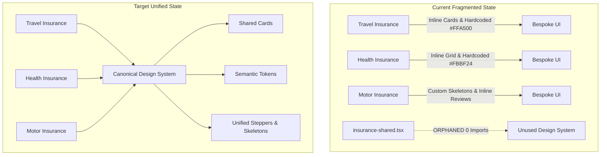
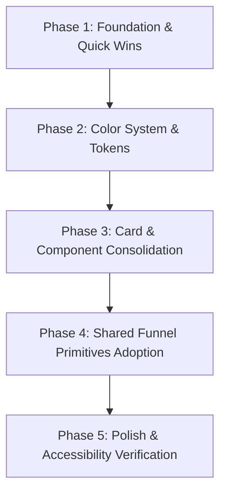

# OneInsurance Ecommerce — UI/UX Audit & Plan for Improvement

**Audit Date:** October 2026  
**Target Application:** `ecommerce` (Next.js 16 Canary App Router, React 19, Tailwind CSS v4, shadcn/ui)  
**Scope:** Client portal storefront, product funnels (Travel, Health, Motor), shared layouts, and reusable component ecosystem. *(Note: Mobile-specific flows deviate intentionally and are recognized as separate valid experiences).*

---

## Executive Summary

The OneInsurance ecommerce platform features a robust modern core (Tailwind v4, Next.js 16, OKLCH color definitions, TanStack Form & Query), but suffers from significant **design system drift and component fragmentation**. Over iterative development cycles, individual product verticals (Travel, Health, Motor) implemented bespoke patterns rather than consuming centralized tokens and shared primitives.



### Key Quantitative Findings

| Dimension | Measured State | Target / Best Practice | Health Rating |
| :--- | :--- | :--- | :--- |
| **Gray Palette** | 9 distinct Tailwind gray steps (420+ instances) | 3 semantic tokens (`muted`, `muted-foreground`, `border`) | 🔴 Critical |
| **Star Rating Colors** | 3 different hex codes (`#FCD34D`, `#FBBF24`, `#FFA500`) | 1 semantic rating token (`--rating` / `amber-400`) | 🔴 Critical |
| **Card Components** | 12+ fragmented card patterns & raw `<div>` wrappers | 1 canonical `Card` component with variants | 🔴 Critical |
| **Shared Primitives** | `insurance-shared.tsx` implemented but **0 imports** | Single source of truth for plans, prices, and CTAs | 🔴 Critical |
| **Global Font Weight** | `* { font-semibold }` on all elements in `globals.css` | Standard `font-normal` body with deliberate hierarchy | 🟡 Warning |
| **Color Contrast** | `--muted-foreground` OKLCH lightness `0.82` (1.6:1 contrast) | WCAG AA compliant ratio (minimum 4.5:1) | 🔴 Critical |
| **Page Backgrounds** | `#eef2f7`, `#F3F5FC`, `#E8E9F3`, `#F8F5EF` hardcoded | Semantic `--background` & `--muted` tokens | 🟡 Warning |

---

## 1. Design Tokens & Color System Audit

### 1.1 The Root Cause: Inaccessible `--muted-foreground`
In `src/app/globals.css`, the light-theme definition for `--muted-foreground` is set to an excessively high lightness:

```css
/* src/app/globals.css:62 */
--muted-foreground: oklch(0.82 0 0);
```

* **The Problem:** An OKLCH lightness of `0.82` against a white background (`oklch(1 0 0)`) results in a contrast ratio of approximately **1.6:1**. The WCAG 2.1 AA minimum requirement is **4.5:1** for body text.
* **The Downstream Ripple Effect:** Because `text-muted-foreground` was virtually illegible, engineering teams stopped using design tokens and manually reached for hardcoded Tailwind gray classes (`text-gray-500`, `text-gray-600`, etc.), destabilizing the design system.

### 1.2 Gray Scale Explosion
Across `src/components` and `src/app`, 9 different raw gray steps are used instead of semantic tokens:

```
text-gray-600: 102 usages
text-gray-500:  93 usages
text-gray-900:  66 usages
text-gray-800:  56 usages
text-gray-400:  53 usages
text-gray-700:  48 usages
text-gray-300:  26 usages
text-gray-100:  21 usages
text-gray-200:  12 usages
```

### 1.3 Star Rating Color Inconsistencies
Customer reviews and star badges display different colors depending on which page or component is viewed:

* [testimonial-card.tsx](file:///Users/john/Develop/oneinsurance/ecommerce/src/components/testimonial-card.tsx#L30): Uses `#FCD34D` (`amber-300`)
* [health-testimonials.tsx](file:///Users/john/Develop/oneinsurance/ecommerce/src/components/health-insurance/health-testimonials.tsx#L92): Uses `#FBBF24` (`amber-400`)
* [motor-insurance/page.tsx](file:///Users/john/Develop/oneinsurance/ecommerce/src/app/(client)/[agent-code]/products/motor-insurance/page.tsx#L825): Uses `#FFA500` (pure CSS orange) with custom `stroke="0.5"`
* [travel-insurance/page.tsx](file:///Users/john/Develop/oneinsurance/ecommerce/src/app/(client)/[agent-code]/products/travel-insurance/page.tsx#L218): Uses `#FFA500` with `stroke="0.5"`

### 1.4 Dual Status & Feedback Color Systems
Two parallel color systems are running simultaneously for alerts and success states:
* **Error/Destructive:** `text-destructive` (55 usages) co-exists with `text-red-500` (44 usages), `text-red-600`, and `text-red-700`.
* **Success/Positive:** No semantic `--success` token exists in `globals.css`. Success states arbitrarily alternate between `text-green-600`, `text-green-700`, `bg-green-600`, or `text-primary`.

### 1.5 Hardcoded Page Background Colors
Instead of utilizing standard `--background` and `--muted` tokens:
* Health insurance pages use hardcoded `bg-[#eef2f7]`
* Motor insurance pages use hardcoded `bg-[#F3F5FC]`
* The global footer uses hardcoded `bg-[#E8E9F3]` ([footer.tsx](file:///Users/john/Develop/oneinsurance/ecommerce/src/components/layout/footer.tsx#L15))
* Dashboard components use hardcoded `#F8F5EF` and gold `#B4975A` ([quick-actions.tsx](file:///Users/john/Develop/oneinsurance/ecommerce/src/components/dashboard/quick-actions.tsx))

### 1.6 Syntax & Configuration Anomalies in CSS
* **Duplicate Directive:** In [globals.css](file:///Users/john/Develop/oneinsurance/ecommerce/src/app/globals.css#L4-L5), `@custom-variant dark (&:is(.dark *));` is defined twice consecutively.
* **Gradient CTAs:** CTAs cycle across 4 different gradient recipes without a defined variant:
  1. `from-primary to-accent` (Primary CTA)
  2. `from-primary to-tertiary`
  3. `from-primary to-lilac`
  4. `from-primary to-primary/80`

---

## 2. Typography & Visual Hierarchy Audit

### 2.1 The Universal Selector Hammer
In [globals.css](file:///Users/john/Develop/oneinsurance/ecommerce/src/app/globals.css#L126-L130):

```css
@layer base {
  * {
    @apply border-border outline-ring/50 font-open-sans font-semibold tracking-tight;
  }
}
```

> [!WARNING]
> Applying `font-semibold` to the universal selector (`*`) forces all paragraphs, spans, labels, tooltips, table cells, and input placeholders to render in semi-bold (600 weight) by default.

**Impact on UX:**
1. **Flattened Information Architecture:** Headings fail to contrast meaningfully with body copy because body copy is also bold.
2. **Dense Reading Experience:** High-volume policy terms, disclosure disclaimers, and table metadata feel heavy and fatigue the reader.
3. **Defensive CSS:** Developers have had to manually add `font-normal` and `font-light` in random sub-components to counteract this global rule.

### 2.2 Heading & Sizing Scales

| Level | Common Classes in Codebase | Issue |
| :--- | :--- | :--- |
| **Page H1** | `text-4xl font-bold` vs `text-2xl sm:text-4xl font-black` | Inconsistent letter-spacing and weight |
| **Section H2** | `text-2xl font-bold` vs `text-3xl font-semibold` | Varies between product pages |
| **Card H3** | `text-lg font-semibold` vs `text-xl font-bold` vs `text-sm font-bold` | No standard card title typography |
| **Labels** | `text-sm font-medium` vs `text-xs font-semibold` vs `text-sm font-semibold` | Form field labels vary between modules |

---

## 3. Card Component Fragmentation

A core finding of this audit is severe **Card Component Fragmentation**. There are at least 12 distinct card-like implementations across the application:

```
┌──────────────────────────────────────────────────────────────────────────────┐
│                            CARD COMPONENT SPECTRUM                           │
├───────────────────────┬──────────────────────┬───────────────────────────────┤
│ shadcn/ui Card        │ Custom Raw <div>     │ Inline Bespoke Implementations│
├───────────────────────┼──────────────────────┼───────────────────────────────┤
│ • ui/card.tsx         │ • insurance-card.tsx │ • travel insurance-plan.tsx   │
│ • ctpl plan-card.tsx  │ • featured-card.tsx  │ • health-plans-grid.tsx       │
│ • metrics-card.tsx    │ • testimonial-card.tsx│ • motor-insurance/page.tsx    │
│ • metric-card.tsx     │ • blog-card.tsx      │   (inline plan cards)         │
│ • chart-card.tsx      │ • details-option-card│                               │
└───────────────────────┴──────────────────────┴───────────────────────────────┘
```

### 3.1 Card Inventory Breakdown

| Component | Path | Wrapper Type | Border Radius | Shadow | Background | Inconsistencies & Issues |
| :--- | :--- | :--- | :--- | :--- | :--- | :--- |
| **`Card` (shadcn)** | `ui/card.tsx` | `<div>` with CVA | `rounded-xl` | `shadow-sm` | `bg-card` | Standard base, but ignored by most product cards |
| **`InsuranceCard`** | `insurance-card.tsx` | Raw `<div>` | `rounded-2xl` (compact)<br>`rounded-md` (expanded) | `shadow-md`<br>`shadow-sm` | `bg-background` | Contains typo bugs: `insurances-center` and `insurances-start` (broken CSS) |
| **`FeaturedCard`** | `featured-card.tsx` | Raw `<div>` | `rounded-lg` | None | Transparent | Hardcodes `border-lilac`, `text-lilac` |
| **`TestimonialCard`** | `testimonial-card.tsx` | Raw `<div>` | `rounded-2xl` | `shadow-sm` | Hardcoded `bg-white` | Ignores `bg-card`, hardcodes `#FCD34D` stars |
| **`BlogCard`** | `blog-card.tsx` | Raw `<div>` | `rounded-2xl` | `shadow-md` | Hardcoded `bg-white` | Ignores `bg-card`, non-standard shadow |
| **`CtplPlanCard`** | `ctpl-insurance/plan-card.tsx` | shadcn `Card` | Inherited (`xl`) | `shadow-sm` | `bg-card` | Square aspect ratio card |
| **`DetailsOptionCard`**| `ctpl-insurance/details-option-card.tsx` | Raw `<div>` | `rounded-lg` | None (hover: `lg`) | Transparent | Uses `border-2`, custom "FASTER" badge |
| **`MetricsCard`** | `dashboard/metrics-card.tsx` | shadcn `Card` | Inherited (`xl`) | `shadow-sm` | `bg-card` | Duplicates `metric-card.tsx` |
| **`MetricCard`** | `reports/metric-card.tsx` | shadcn `Card` | Inherited (`xl`) | `shadow-sm` | `bg-card` | Duplicates `metrics-card.tsx` |
| **`TravelInsurancePlan`** | `travel-insurance/insurance-plan.tsx` | Custom 360-line card | `rounded-xl` | `shadow-md` | `bg-white` | Complex inline structure, bespoke carrier badges |
| **`HealthPlansGrid`** | `health-insurance/health-plans-grid.tsx` | Custom 420-line grid | `rounded-2xl` | `shadow-sm` | `bg-white` | Inline card layout, separate from travel plan cards |

### 3.2 Specific Bug in `insurance-card.tsx`
In [src/components/insurance-card.tsx](file:///Users/john/Develop/oneinsurance/ecommerce/src/components/insurance-card.tsx#L97):
```tsx
// Lines 97 and 130
className={cn("insurances-center z-10 flex gap-1 ...")} // Invalid class! Should be items-center
className="insurances-start mb-2 flex justify-between"  // Invalid class! Should be items-start
```
An automated text replacement accident converted `items` to `insurances`, leaving broken alignment rules in production.

---

## 4. Component Duplication & Anti-Patterns

### 4.1 Banners: `ProductBanner` vs `InsuranceBanner`
[product-banner.tsx](file:///Users/john/Develop/oneinsurance/ecommerce/src/components/product-banner.tsx) and [insurance-banner.tsx](file:///Users/john/Develop/oneinsurance/ecommerce/src/components/insurance-banner.tsx) share 90% identical markup, including a hardcoded Google Image Search thumbnail URL:
`https://encrypted-tbn0.gstatic.com/images?q=tbn:ANd9GcQtj8FwB7UMmu3dgQnzdMD4ZPWurow1z6IIgw&s`

Furthermore, `InsuranceBanner` exposes an `availNowLink` prop but hardcodes `<Link href={'#avail'}>`, ignoring the prop:
```tsx
// src/components/insurance-banner.tsx:39-48
<Button size="lg" variant="outline" className="... rounded-md ..." asChild>
  <Link href={'#avail'} className="... rounded-full ..."> {/* Conflicting radius & ignored prop */}
    <p className="px-4">Avail Now</p>
    <MoveRight />
  </Link>
</Button>
```

### 4.2 Steppers & Progress Indicators
* **[ui/stepper.tsx](file:///Users/john/Develop/oneinsurance/ecommerce/src/components/ui/stepper.tsx)**: Modern, responsive stepper supporting step descriptions, gradient indicators, and mobile-friendly modes.
* **[travel-insurance/step-indicator.tsx](file:///Users/john/Develop/oneinsurance/ecommerce/src/components/travel-insurance/step-indicator.tsx)**: Hardcoded 47-line indicator using `bg-green-600` and `bg-gray-200`, completely ignoring `ui/stepper.tsx`.

### 4.3 Metric Cards
* **[dashboard/metrics-card.tsx](file:///Users/john/Develop/oneinsurance/ecommerce/src/components/dashboard/metrics-card.tsx)**: Accepts `changeType: boolean`, uses `text-green-700` and `text-red-700`.
* **[reports/metric-card.tsx](file:///Users/john/Develop/oneinsurance/ecommerce/src/components/reports/metric-card.tsx)**: Accepts `changeType: 'increase' | 'decrease'`, uses `text-green-600` and `text-red-600`.
* Both components render a KPI title, icon, value, and trend percentage.

### 4.4 The Orphaned Design System: `insurance-shared.tsx`
A dedicated shared component file exists at [src/components/ui/insurance-shared.tsx](file:///Users/john/Develop/oneinsurance/ecommerce/src/components/ui/insurance-shared.tsx):
* `PrimaryActionButton`
* `PlanCardSkeleton`
* `PlansLoadingState`
* `PriceDisplay`
* `SortFilterSidebar`
* `NoPlanState`

> [!IMPORTANT]
> **Adoption Status:** Exact grep across `src/` reveals that **0 components import `insurance-shared.tsx`**.
> Every product team rolled bespoke inline skeletons, buttons, and error blocks instead of using the purpose-built shared module.

---

## 5. Layout, Spacing & Container Patterns

### 5.1 Container Width Disparities
Across pages and sections, outer wrappers switch unpredictably between max-width constraints:
* `max-w-7xl` (50 usages) — used in Header, Footer, and main layout wrappers
* `max-w-6xl` (8 usages) — used in step indicator and travel funnel
* `max-w-5xl` (4 usages) — used in quotation review
* `w-11/12 md:w-[30rem]` — used in `InsuranceCard` expanded variant
* `max-w-2xl` & `max-w-md` — used in standalone modal/forms

### 5.2 Border Radius Scale Chaos
8 different border radii are scattered across components without semantic guidelines:

```
rounded-full: 217 usages  (Buttons, pills, badges, inputs, avatars)
rounded-md:    71 usages  (Buttons, expanded cards, dialogs)
rounded-lg:    60 usages  (Option cards, featured cards)
rounded-xl:    25 usages  (shadcn Card default, plan cards)
rounded-2xl:   20 usages  (Blog cards, testimonials, compact insurance cards)
rounded-sm:    13 usages  (Minor tags)
rounded-3xl:    4 usages  (Hero sections)
rounded-xs:     2 usages  (Tags)
```

---

## 6. Plan for Improvement (Phased Roadmap)



### Phase 1: Foundation & Quick Wins (Immediate / Low Risk)
* [x] **Fix CSS Syntax in `globals.css`:** Remove duplicate `@custom-variant dark` on line 5.
* [x] **Tame Universal Selector Hammer:** Move `font-semibold` off `*` in `globals.css`. Set `body { @apply font-open-sans font-normal; }` and apply `font-semibold` / `font-bold` intentionally to headings and titles.
* [x] **Correct Invalid CSS in `insurance-card.tsx`:** Fix `insurances-center` $\to$ `items-center` and `insurances-start` $\to$ `items-start`.
* [x] **Fix Prop Bug in `insurance-banner.tsx`:** Wire `availNowLink` prop to the actual `<Link href={availNowLink}>`.

### Phase 2: Color System & Design Token Consolidation
* [x] **Fix `--muted-foreground` Contrast:** Update `--muted-foreground` in `globals.css` light mode from `oklch(0.82 0 0)` to an accessible tone (`oklch(0.55 0 0)` or `oklch(0.45 0 0)`, matching ~WCAG 4.5:1+). → implemented as `oklch(0.556 0 0)` (~4.9:1).
* [x] **Establish Semantic Status Tokens:**
  * Add `--success: oklch(0.62 0.17 145);` and `--success-foreground`.
  * Add `--warning: oklch(0.75 0.16 75);` and `--warning-foreground`.
  * Add `--rating: #FBBF24;` (amber-400) as the single token for review stars. → implemented as `oklch(0.83 0.162 84.6)`; also added `--section` for tinted page sections.
* [x] **Deprecate Hardcoded Grays:** Incrementally migrate raw `text-gray-600` / `text-gray-500` to `text-muted-foreground` and `text-gray-900` to `text-foreground`. → 1,000+ raw palette classes migrated codemod-wide (grays → `foreground`/`muted-foreground`/`muted`/`border`; `red-*` → `destructive`; `green-*` → `success`; `amber-*`/`yellow-*` → `warning`). Residual dark-surface shades (`bg-gray-700+`, `text-green-200` on `bg-green-900` badges) intentionally left.
* [x] **Unify Background Tones:** Replace hardcoded `#eef2f7` (Health) and `#F3F5FC` (Motor) with a single `bg-muted/50` or semantic section background. → unified under new `bg-section` token (incl. `#E8E9F3` footer, `#F8F5EF`/`#B4975A` dashboard accents → `bg-muted`/`bg-primary`).

### Phase 3: Card & Component Consolidation
* [x] **Unify the Card Hierarchy:** Standardize all cards around shadcn `Card` primitives (`src/components/ui/card.tsx`), providing 3 consistent variants: → CVA `variant` prop added (`default` / `interactive` / `featured`). All funnel cards re-parented onto `Card`: `insurance-plan.tsx` (interactive), `health-plans-grid.tsx`, `motor-insurance/page.tsx` plan cards, `testimonial-card.tsx`, `health-testimonials.tsx`, `tier-comparison-matrix.tsx` table card.
  1. `default` (`rounded-xl border bg-card shadow-sm`)
  2. `interactive` (`rounded-xl border bg-card shadow-sm hover:shadow-md transition-shadow`)
  3. `featured` (`rounded-xl border-2 border-primary/20 bg-card shadow-md`)
* [x] **Consolidate Banner Components:** Deprecate `product-banner.tsx`. Enhance `insurance-banner.tsx` to handle both CTA and non-CTA variants with configurable imagery (removing hardcoded Google thumbnail URLs). → `product-banner.tsx` deleted; `InsuranceBanner` now takes `imageUrl?` / `availNowLink?` / `availNowLabel?`.
* [x] **Consolidate Metric Cards:** Merge `dashboard/metrics-card.tsx` and `reports/metric-card.tsx` into a single reusable `MetricCard`. → merged into `src/components/ui/metric-card.tsx` (unified props API, auto value formatting, `success`/`destructive` trend colors).
* [x] **Consolidate Steppers:** Deprecate `travel-insurance/step-indicator.tsx` in favor of the responsive `src/components/ui/stepper.tsx`. → file deleted; it had 0 imports (all avail funnels already used `ui/stepper.tsx`).

### Phase 4: Product Funnel Adoption of `insurance-shared.tsx`
* [x] **Adopt `PlansLoadingState`:** Replace inline skeletons in `motor-insurance/page.tsx` and `health-plans-grid.tsx` with `PlansLoadingState`. → both now use `PlanCardSkeleton` rows (the `PlansLoadingState` building block) inside their existing header/sidebar skeletons; `NoPlanState` adopted for both error states.
* [x] **Adopt `PriceDisplay`:** Use `PriceDisplay` for standardizing PHP currency formatting and symbol layout across Travel, Health, and CTPL. → adopted in `health-plans-grid.tsx`, `motor-insurance/page.tsx`, `travel-insurance/insurance-plan.tsx`, `tier-comparison-matrix.tsx` (`currency` prop added for non-PHP plans).
* [x] **Adopt `PrimaryActionButton`:** Standardize the main quotation submission and "Avail Now" buttons across all funnels. → adopted for all "Apply Now"/"Search Plans" CTAs; `SortFilterSidebar` adopted by Health + Motor (Travel keeps its advanced collapsible sidebar — already token-compliant).

### Phase 5: Polish & Accessibility Verification
* [x] **Contrast Verification:** Run automated axe-core/Lighthouse audits on all main landing and checkout views. → axe-core 4.12 run via agent-browser on `/{agent}`, `/products/travel-insurance`, `/products/health-insurance`: **0 violations**. Fixed en route: `--muted-foreground` → `oklch(0.51)` (was 4.12:1 on `bg-section`), `--lilac` → `oklch(0.5)` (white text was 3.45:1), `--success` → `oklch(0.48)`, `--warning` → `oklch(0.55)`, `AvatarFallback` → `text-muted-foreground`, footer subscribe button + `ComboBox` → `aria-label`s. Remaining `incomplete` items are expected (closed Radix popovers, text over hero imagery — axe can't determine backgrounds).
* [x] **Form Error Consistency:** Ensure validation error states from `@tanstack/react-form` use `text-destructive` and `border-destructive` uniformly across all input fields. → all `text-red-*`/`border-red-*` migrated to `destructive` tokens.
* [x] **Star Rating Component:** Extract a reusable `<StarRating rating={value} />` component that encapsulates star SVG stroke, fill, and rating math. → created `src/components/ui/star-rating.tsx` using `--rating`; adopted in `testimonial-card.tsx`, `health-testimonials.tsx`, `travel-insurance/page.tsx`, `motor-insurance/page.tsx`.

---

## Summary Matrix: Current vs Proposed Architecture

| Component / Token | Current State | Proposed Unified State | Target File |
| :--- | :--- | :--- | :--- |
| **Star Rating** | `#FCD34D`, `#FBBF24`, `#FFA500` | `<StarRating rating={n} />` using `--rating` | `src/components/ui/star-rating.tsx` |
| **Card Base** | 12+ separate `div` / `Card` styles | Single shadcn `Card` with CVA variants | `src/components/ui/card.tsx` |
| **Banners** | 2 duplicate components + hardcoded URL | Single `<InsuranceBanner />` with props | `src/components/insurance-banner.tsx` |
| **Steppers** | 2 separate step indicators | Single `<Stepper />` | `src/components/ui/stepper.tsx` |
| **Muted Text** | 9 shades of `text-gray-*` | `text-muted-foreground` | Global standard |
| **Page Funnels** | Bespoke inline skeletons & loaders | Shared `insurance-shared.tsx` primitives | `src/components/ui/insurance-shared.tsx` |
